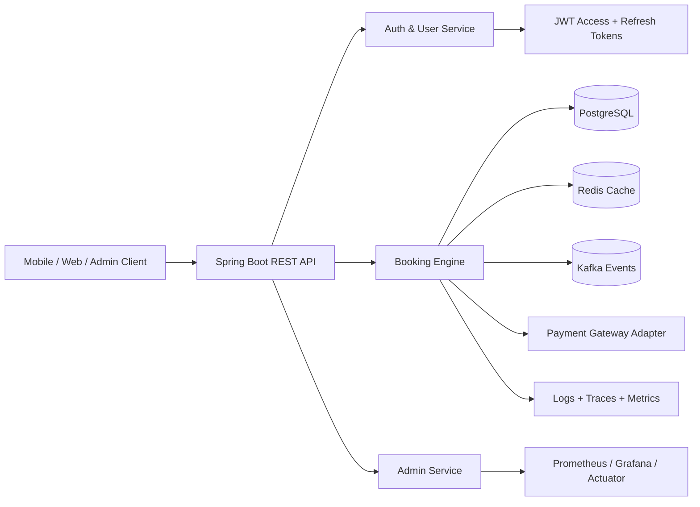

# Railway Booking Platform - HLD / LLD

## 1. Project goal

Is project ka primary objective ek production-style railway booking backend banana hai jisme:

- high concurrency
- seat inventory integrity
- payment + booking consistency
- idempotent retry handling
- JWT access/refresh token flow
- Redis cache
- Kafka eventing
- multi-threading safe seat locking
- observability and monitoring

Ye project `Underdevelopment` repo se inspired hai, par isko blindly copy nahi kiya gaya. Isme domain models ko improve karke, missing security and token flow add kiya gaya, aur architecture ko layered, scalable design ke hisaab se organize kiya gaya hai.

## 2. Core business problem

Tatkal-like booking scenario me 10,000 users same train, same coach, same seat pool par attempt kar sakte hain. Agar seat availability simple boolean hoti, to race condition create hoti hai.

Solution design:

- seat ko state-based model me rakha jayega: AVAILABLE, HOLD, BOOKED, BLOCKED
- booking lifecycle ko separate state machine bana kar manage kiya jayega
- payment success/failure ko booking status se alag rakha jayega
- database me final consistency surakshit rakhi jayegi
- application-level logic sirf optimization karta hai; database final source of truth hai

## 3. High Level Design (HLD)



### HLD principles

1. Presentation layer: REST controllers, request validation
2. Application layer: auth, booking orchestration, user management
3. Domain layer: Train, Coach, Seat, Journey, Booking, RefreshToken
4. Data layer: JPA + Redis + Kafka
5. Security layer: JWT + BCrypt + stateless auth
6. Operational layer: metrics, tracing, health checks

## 4. Low Level Design (LLD)

### 4.1 Domain objects

- User
  - id, username, email, password, role, status
  - security + profile data

- Train
  - trainNumber, trainName, status

- Station
  - stationCode, stationName

- Coach
  - trainId, coachNumber, coachType, seatCapacity, status

- Seat
  - coachId, seatNumber, seatType, status

- Journey
  - trainId, fromStation, toStation, date, departure, arrival

- Booking
  - userId, journeyId, coachId, seatId, bookingRef, paymentStatus, bookingStatus, amount

- RefreshToken
  - userId, token, expiry, revoked

### 4.2 Security design

- Access token: short-lived, used for API auth
- Refresh token: long-lived, used to mint new access token
- Passwords: BCrypt encoded
- Authorization: role-based via Spring Security

### 4.3 Booking flow

```text
Book seat request
   -> validate user + route + coach + date
   -> check cache / DB seat inventory
   -> mark seat HOLD / lock using DB transaction
   -> confirm payment
   -> update booking status to CONFIRMED
   -> release/rollback if payment fails
```

### 4.4 Concurrency strategy

- Database final source of truth
- optimistic/pessimistic locking approach in production-grade implementation
- Redis single-flight / distributed lock for hot inventory keys
- Kafka events for async payment confirmation and seat release

## 5. Why this project is better than a naive CRUD version

- It does not treat booking as one boolean field only
- It separates user identity, seat state, payment state, booking state, and retry lifecycle
- It uses access/refresh token model for real token-based auth
- It supports future microservice split into:
  - User Service
  - Train/Inventory Service
  - Booking Service
  - Payment Service
  - Notification Service

## 6. Recommended future microservice split

```text
User Service              -> auth, profile, roles
Train Service             -> routes, coaches, seat definitions
Inventory Service         -> availability, hold, release
Booking Service           -> booking creation, status transitions
Payment Service           -> payment callback + refund
Notification Service      -> email/SMS/PnR updates
```

## 7. Implementation notes for this repo

Current project me important improvements already add kiye gaye hain:

- JWT access + refresh token support
- BCrypt password encoding
- Spring Security stateless config
- Role-aware model
- Domain model for Train / Coach / Seat / Journey / Booking
- Hindi comments in classes for readability
- refresh-token lifecycle service

## 7.1 Journey module status (current milestone)

Journey phase ko complete kar diya gaya hai. Is milestone me implementation include kiya gaya hai:

- Journey entity improved with route + date + time mapping
- JourneyRepository me route/date query support
- JourneyRequestDTO / JourneyResponseDTO / SearchJourneyRequestDTO
- JourneyService + JourneyServiceImpl
- JourneyController with create/get/search endpoints
- validation for invalid route, missing data, and unavailable journey
- global exception handling for 400/404 responses
- seed data for a default train + station + journey for local validation

Required live APIs:

- POST /api/journeys (ADMIN only)
- GET /api/journeys/{id}
- GET /api/journeys/search?fromStationId=...&toStationId=...&journeyDate=YYYY-MM-DD
- GET /api/journeys

Journey ko sirf entity level tak nahi rakha gaya; service + controller + DTO + DB validation + live API test ke saath implement kiya gaya hai.

## 7.2 GitHub railway-data import

The one-time master-data importer uses the MIT-licensed
[Indian-Railway-Data dataset](https://github.com/prasenjit-27/Indian-Railway-Data), pinned to a repository
commit for a reproducible import. It downloads `stations.json` and imports station code, name, and state while
leaving city null and preserving any existing city. It then streams `trains.json` and imports up to the
requested number of trains into the existing `Train`, `TrainRoute`, and `TrainStop` tables.

Before importing into an existing PostgreSQL database, apply
[`002_allow_null_station_city.sql`](./database/migrations/002_allow_null_station_city.sql). This permits new
dataset stations, for which the source provides no city, to be stored without inventing one.

The endpoint is ADMIN-only:

```powershell
$headers = @{ Authorization = "Bearer $env:ADMIN_ACCESS_TOKEN" }
Invoke-RestMethod -Method Post -Uri "http://localhost:8080/api/admin/import/github-railway?maxTrains=1" -Headers $headers
```

`maxTrains` defaults to 1 so the first call is a small train sample; all station records are imported because
the train route stops reference that station master. To import the complete train dataset after verifying the
sample, use `maxTrains=5208`. Stations and train/route/stop records are written in one transaction. Repeated
imports reuse station codes and train numbers, reuse identical routes, and reject a conflicting existing route.

The importer maps `journeyDay` relative to the first route stop into `TrainStop.dayOffset`; nullable arrival and
departure times are preserved. Dataset fields without existing normalized columns, including zone, coordinates,
train type, running days, and distances, are intentionally ignored.

## 7.3 RailRadar master-data import (legacy)

RailRadar is used only by explicit ADMIN sync requests. Normal journey search, seat availability, holds, and bookings continue to use local PostgreSQL data and do not call RailRadar.

Configure the external service without storing credentials in source:

```powershell
$env:RAILRADAR_BASE_URL = "https://api.railradar.in/v1"
$env:RAILRADAR_API_KEY = "<your RailRadar API key>"
```

The sync client sends the key in the `X-API-Key` header. Missing configuration or upstream errors fail the sync request without preventing normal application startup.

### Import stations

`POST /api/admin/sync/railradar/stations` requires an ADMIN bearer token. It searches RailRadar station data and upserts the returned stations by station code. The request contains only `query` and optional `limit`.

Station state is optional in the application because current journey, route, booking, and seat functionality does not use it. The importer stores the station code, name, and city from RailRadar, preserves an existing local state, and never guesses a state. If a required station code, name, or city is missing, that station is skipped and reported in `unresolved`; valid records are persisted together transactionally.

```json
{
  "query": "New Delhi",
  "limit": 10
}
```

Before the first import into an existing PostgreSQL database, apply `database/migrations/001_allow_null_station_state.sql` so the existing `stations.state` column permits null. `limit` may be 5, 10, 20, or 50; it defaults to 10. The response reports fetched, inserted, updated, unchanged, skipped, and unresolved station records. An import containing unresolved stations may still persist its resolvable stations; a database failure rolls back the persistence transaction.

### Import a train timetable

`POST /api/admin/sync/railradar/trains/{trainNumber}` requires an ADMIN bearer token and fetches the timetable for a five-digit train number. All timetable station codes must already exist in local `stations`; import them first. The train is upserted by train number and its RailRadar timetable is stored in `train_routes` and `train_stops`.

An identical repeat sync reuses the existing route and stops. If an existing saved timetable differs from RailRadar's response, the operation returns a conflict rather than replacing route data that may be referenced by dated journeys. The current `TrainStop` model has one day offset per stop; timetable stops with different arrival and departure offsets are rejected rather than approximated.

Reference contracts: [RailRadar station search](https://railradar.in/docs/search-stations) and [RailRadar train details/timetable](https://railradar.in/docs/get-train-details).

## 8. Production hardening roadmap

1. Add Redis cache for fare and availability lookup
2. Add distributed lock around seat hold logic
3. Add Kafka events for `BOOKING_CREATED`, `PAYMENT_SUCCEEDED`, `SEAT_RELEASED`
4. Add database indexes on route/date/coach/seat queries
5. Add Prometheus metrics and actuator endpoints
6. Add rate limiting and request throttling for Tatkal window
7. Add idempotency keys for payment retries
8. Add retry-safe payment callback processing

## 9. Suggested next steps

Agar is project ko production-grade banaana ho to next milestone hoga:

- Payment service integration
- Booking transaction orchestration
- Redis lock + Kafka workflow
- PNR generation logic
- Cancellations + refund handler
- Load testing with thousands of concurrent booking requests

## 10. Summary

Ye project sirf user registration nahi hai. Ye ek real-world railway booking system ka skeleton hai jo scalability, concurrency safety, and enterprise-grade architecture ko support karta hai.

Underdevelopment repo ne domain ideas provide kiye. Is project ne usko refine karke cleaner architecture, token security, and modular design diya hai.
