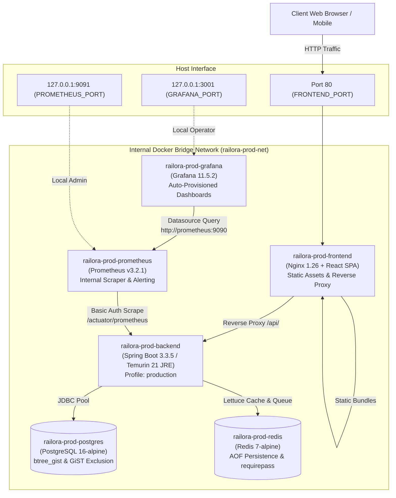

# Railora — Phase 17.2: Unified Docker Compose Orchestration

> **Classification:** Production Deployment Architecture & Orchestration Guide  
> **Status:** Implemented & Statically Validated  
> **Target Repository:** `D:\railway-github-check\Railway-Booking-System`  
> **Compose File:** `docker-compose.yml`  
> **Environment Template:** `.env.example`

---

## 1. Architecture Overview

Railora Phase 17.2 delivers a production-grade, multi-container orchestration architecture uniting the six core services of the booking platform under a secure internal bridge network (`railora-prod-net`):



---

## 2. Service Descriptions

### 1. `postgres` (Relational Database)
- **Image:** `postgres:16-alpine`
- **Container Name:** `${COMPOSE_PROJECT_NAME:-railora}-postgres`
- **Volume:** `postgres_data` mounted at `/var/lib/postgresql/data`.
- **Initialization & Migrations:** Upon startup, PostgreSQL launches with superuser credentials. When the Spring Boot backend initializes, Flyway runs migrations `V1__` through `V7__`, installing the required `btree_gist` extension, the integer segment range columns (`int4range`), the authoritative GiST exclusion constraint (`seat_alloc_no_overlap_excl`), outbox staging tables, and webhook deduplication logs.
- **Database Isolation:** Connects to dedicated database `railway_booking_prod` (strictly isolated from development `railway_booking` and test `railway_booking_test`).
- **Healthcheck:** Evaluates readiness via `pg_isready -U ${POSTGRES_USER} -d ${POSTGRES_DB}` every 10 seconds.

### 2. `redis` (Cache & Tatkal Queue Store)
- **Image:** `redis:7-alpine`
- **Container Name:** `${COMPOSE_PROJECT_NAME:-railora}-redis`
- **Command:** `redis-server --requirepass ${REDIS_PASSWORD} --appendonly yes --appendfsync everysec --maxmemory ${REDIS_MAXMEMORY:-512mb} --maxmemory-policy noeviction`
- **Volume:** `redis_data` mounted at `/data`.
- **Persistence & Durability Strategy:**
  - **Authoritative Booking Store:** PostgreSQL is the single source of truth for all confirmed bookings, tickets, and seat allocations. The PostgreSQL GiST exclusion constraint (`seat_alloc_no_overlap_excl`) on `seat_allocations` provides 100% ACID consistency and mathematical prevention of overlapping reservations. Confirmed bookings never depend on Redis.
  - **Redis Role & AOF Durability:** Redis acts as an in-memory high-speed cache and Tatkal queue admission gateway. AOF with `everysec` synchronization provides best-effort recovery of queue ordering across unexpected restarts (with at most 1 second journal lag). However, AOF does **not** guarantee zero queue data loss: Tatkal admission tokens have explicit TTLs (5–10 minutes) and will naturally expire if downtime exceeds their lifetime.
  - **Eviction Policy (`noeviction`) & Memory Limit:** Redis is bounded by `--maxmemory 512mb` and configured with `--maxmemory-policy noeviction`. Eviction policies like `volatile-lru` or `allkeys-lru` are strictly prohibited because they would silently evict active Tatkal queue hashes (`tatkal:{journeyId}:entry:{entryId}`), corrupting the waiting queue and admission state. Under `noeviction`, if memory fills up:
    - Read operations continue unaffected.
    - Cache PUTs fail open via `ResilientCacheErrorHandler` (transparent fallback to PostgreSQL).
    - New Tatkal queue joins fail closed (clean exception, preserving existing queue state integrity).
- **Healthcheck:** Evaluates authenticated ping (`redis-cli -a "$$REDIS_PASSWORD" ping`) every 10 seconds.

### 3. `backend` (Spring Boot Application)
- **Build:** Built from the root `Dockerfile` using multi-stage Maven 3.9 + Temurin 21.
- **Runtime User:** Non-root user `app` (`UID/GID 1000`).
- **Profile:** Strictly set to `SPRING_PROFILES_ACTIVE=production`.
- **Payment Safety:** `RAILWAY_PAYMENT_SIMULATED_ENABLED=false` and `RAILWAY_PAYMENT_MOCK_ENABLED=false` are hardcoded in the compose environment, ensuring test payment modes are strictly disabled. `RAZORPAY_ENABLED=false` by default.
- **Port Exposure:** Exposes port `8080` internally only on `railora-prod-net`. No host port mapping is declared, enforcing the principle of least privilege and preventing port conflicts with host processes.
- **Lifecycle:** Configured for graceful shutdown with a 30-second phase timeout (`server.shutdown=graceful`, `spring.lifecycle.timeout-per-shutdown-phase=30s`).
- **Healthcheck:** Evaluates liveness probe `wget -qO- http://localhost:8080/livez` every 15 seconds.

### 4. `frontend` (Nginx + React SPA)
- **Build:** Built from `railora/Dockerfile` using multi-stage Node 22 + Nginx stable alpine.
- **Reverse Proxy:** Directs all `/api/` traffic to `http://backend:8080` while preserving original paths, request bodies, query parameters, and `Authorization` headers.
- **Probe Proxying:** Proxies only `/actuator/health`, `/livez`, and `/readyz`. Sensitive endpoints (e.g., `/actuator/prometheus`) are blocked and served as React SPA fallback routes.
- **Host Binding:** Binds to `${FRONTEND_PORT:-80}:80`.
- **Healthcheck:** Probes `http://localhost:80/livez` every 15 seconds.

### 5. `prometheus` (Metrics & Alerting Engine)
- **Image:** `prom/prometheus:v3.2.1`
- **Configuration:** Mounts `monitoring/prometheus/prometheus-compose.yml` to `/etc/prometheus/prometheus.yml:ro` and `monitoring/prometheus/alerts` to `/etc/prometheus/alerts:ro`.
- **Target:** Scrapes `backend:8080/actuator/prometheus` inside the bridge network using HTTP Basic Authentication (`promuser`).
- **Secret File Mount:** Credentials are not hardcoded. Mounts `${METRICS_PASSWORD_FILE:-./monitoring/secrets/metrics_password}` to `/etc/prometheus/secrets/metrics_password:ro`, read by Prometheus via `basic_auth.password_file`.
- **Port Binding:** Strictly bound to localhost (`127.0.0.1:${PROMETHEUS_PORT:-9091}:9090`) to prevent public exposure.
- **Volume:** `prometheus_data` mounted at `/prometheus` with a 30-day retention window.

### 6. `grafana` (Observability Dashboards)
- **Image:** `grafana/grafana:11.5.2`
- **Provisioning:** Mounts `monitoring/grafana/provisioning` (auto-registers Prometheus datasource at `http://prometheus:9090`) and `monitoring/grafana/dashboards` (provisions the 4 Railora production dashboards).
- **Security:** Anonymous access disabled (`GF_AUTH_ANONYMOUS_ENABLED=false`), sign-up disabled (`GF_USERS_ALLOW_SIGN_UP=false`), admin password enforced via environment variable.
- **Port Binding:** Strictly bound to localhost (`127.0.0.1:${GRAFANA_PORT:-3001}:3000`).
- **Volume:** `grafana_data` mounted at `/var/lib/grafana`.

---

## 3. Environment Variable Reference

The complete template is provided in [.env.example](file:///D:/railway-github-check/Railway-Booking-System/.env.example). All variables must be set prior to running the stack.

| Variable Name | Required | Default in `.env.example` | Description |
|---|---|---|---|
| `COMPOSE_PROJECT_NAME` | Optional | `railora-prod` | Compose project namespace (prefixes containers, volumes, networks) |
| `FRONTEND_PORT` | Optional | `80` | Host port for Nginx frontend. If port 80 is occupied (e.g., Windows IIS/Apache) or unprivileged port is desired, override to `8080` or `8000` |
| `PROMETHEUS_PORT` | Optional | `9091` | Host port for Prometheus web UI (bound to `127.0.0.1`) |
| `GRAFANA_PORT` | Optional | `3001` | Host port for Grafana dashboards (bound to `127.0.0.1`) |
| `POSTGRES_DB` | Required | `railway_booking_prod` | Dedicated production database name |
| `POSTGRES_USER` | Required | `railora_user` | PostgreSQL application user |
| `POSTGRES_PASSWORD` | **MANDATORY** | *(Placeholder)* | PostgreSQL password (fail-safe check enforces non-blank) |
| `REDIS_PASSWORD` | **MANDATORY** | *(Placeholder)* | Redis authentication password (`--requirepass`) |
| `REDIS_MAXMEMORY` | Optional | `512mb` | Redis memory limit enforced with `--maxmemory-policy noeviction` |
| `JWT_ACCESS_SECRET` | **MANDATORY** | *(Placeholder)* | Base64-encoded secret for access tokens (minimum 256 bits / 32 bytes) |
| `JWT_REFRESH_SECRET` | **MANDATORY** | *(Placeholder)* | Base64-encoded secret for refresh tokens (minimum 256 bits / 32 bytes) |
| `JWT_ACCESS_EXPIRATION_MS` | Optional | `900000` | Access token lifetime in milliseconds (15 minutes) |
| `JWT_REFRESH_EXPIRATION_MS` | Optional | `604800000` | Refresh token lifetime in milliseconds (7 days) |
| `CORS_ALLOWED_ORIGINS` | Required | `http://localhost,http://localhost:80,http://127.0.0.1` | Permitted browser origins for API calls |
| `RAILWAY_BASE_FARE` | Required | `500.00` | Fixed server-side ticket booking fare in INR |
| `METRICS_SCRAPE_AUTH_ENABLED` | Required | `true` | Enables HTTP Basic Auth on `/actuator/prometheus` |
| `METRICS_USER` | Required | `promuser` | Metrics scraping username |
| `METRICS_PASSWORD` | **MANDATORY** | *(Placeholder)* | Metrics scraping password matching `monitoring/secrets/metrics_password` |
| `METRICS_PASSWORD_FILE` | Optional | `./monitoring/secrets/metrics_password` | Host path to mounted Prometheus password file |
| `GRAFANA_ADMIN_USER` | Required | `admin` | Grafana superuser username |
| `GRAFANA_ADMIN_PASSWORD` | **MANDATORY** | *(Placeholder)* | Grafana superuser password |
| `PROMETHEUS_RETENTION` | Optional | `30d` | Time-series data retention window |
| `RAZORPAY_ENABLED` | Optional | `false` | Enables Razorpay gateway integration |
| `RAILWAY_OUTBOX_KAFKA_ENABLED` | Optional | `false` | Enables outbox relay publication to Kafka |

---

## 4. Startup Sequence & Dependency Management

Compose startup is governed by container healthchecks rather than mere process startup:

```
[1. postgres]  ──(healthy: pg_isready)──┐
                                         ├─► [3. backend] ──(healthy: /livez)─► [4. frontend]
[2. redis]     ──(healthy: ping)────────┘        │
                                                 └─► [5. prometheus] ──(healthy)─► [6. grafana]
```

1. **Phase 1 (Data Stores):** `postgres` and `redis` spin up independently.
2. **Phase 2 (Database Readiness):** `postgres` runs `pg_isready` checks; `redis` validates `PONG` response.
3. **Phase 3 (Core Application):** `backend` begins startup only after both `postgres` and `redis` are reported `healthy`. Flyway runs schema migrations, verifies database isolation, and starts Tomcat.
4. **Phase 4 (Gateways & Telemetry):**
   - `frontend` waits for `backend` to pass the `/livez` health probe before opening public port 80.
   - `prometheus` waits for `backend` to pass health checks before initiating scrape jobs.
   - `grafana` waits for `prometheus` to report healthy before initializing dashboards.

---

## 5. Deployment Commands & Operational Guide

### 1. Preparation
Copy the environment template and populate secrets:
```bash
cp .env.example .env
# Edit .env with your favorite editor and configure strong secrets
```

### 2. Configuration Validation (Dry Run)
Verify syntax, variable interpolation, and dependency linkages without starting containers:
```bash
docker compose config
```

### 3. Build All Application Images
Build the backend and frontend images using local context:
```bash
docker compose build
```

### 4. Deploying the Unified Stack (Runtime Execution)
Start the complete stack in detached mode:
```bash
docker compose up -d
```

### 5. Service Status & Health Inspection
Inspect running container states and probe health:
```bash
docker compose ps
```

### 6. Streaming Application Logs
Stream logs from a specific service:
```bash
docker compose logs -f backend
docker compose logs -f frontend
```

### 7. Graceful Stack Teardown
Stop all containers while strictly preserving persistent database, Redis, and metrics volumes:
```bash
docker compose down
# DO NOT pass -v (preserves postgres_data, redis_data, prometheus_data, grafana_data)
```

---

## 6. Security & Hardening Safeguards

1. **Fail-Safe Secret Validation:** All critical credentials (`POSTGRES_PASSWORD`, `REDIS_PASSWORD`, `JWT_ACCESS_SECRET`, `JWT_REFRESH_SECRET`, `GRAFANA_ADMIN_PASSWORD`) utilize Compose required-variable validation (`${VAR:?error_message}`). If an administrator attempts to launch the stack with a missing secret, Compose immediately halts.
2. **Database Isolation:** Database defaults to `railway_booking_prod`. Development and test databases on the host remain completely unreferenced and untouched.
3. **Backend Network Isolation:** Port `8080` is never mapped to the host interface. It is reachable exclusively via the internal bridge network from Nginx and Prometheus.
4. **Actuator Perimeter Protection:** Nginx explicitly proxies only `/actuator/health`, `/livez`, and `/readyz`. All other Actuator paths (`/actuator/prometheus`, `/actuator/env`, etc.) hit the SPA fallback and are not routed to Spring Boot.
5. **Metrics Basic Auth Isolation:** Scrapes to `/actuator/prometheus` require valid HTTP Basic credentials evaluated by `MetricsSecurityConfig` at `@Order(1)`.
6. **Non-Root Container Users:** Both backend (`USER app`) and frontend (`nginx` unprivileged) execute under restricted UIDs without host root access.

---

## 7. Disaster Recovery & Backup Considerations

- **PostgreSQL Volume Backup:** The persistent volume `postgres_data` should be backed up regularly using automated snapshots or `pg_dump`:
  ```bash
  docker compose exec -T postgres pg_dump -U railora_user -d railway_booking_prod | gzip > backup_$(date +%Y%m%d_%H%M%S).sql.gz
  ```
- **Redis AOF Durability:** Redis volume `redis_data` retains the Append-Only File (`appendonly.aof`). For cold backups, copy the contents of the `/data` directory while the container is running or during scheduled maintenance.
- **Prometheus TSDB Backups:** Historical metrics are stored in `prometheus_data`. To snapshot TSDB data, execute a snapshot API call against `http://localhost:9091/api/v1/admin/tsdb/snapshot` (lifecycle enabled).

---

## 8. Known Limitations & Future Enhancements

1. **TLS / HTTPS Termination:** The Compose stack listens on HTTP port 80. In production cloud environments, TLS certificates (HTTPS port 443) should be terminated at an external ingress layer (AWS Application Load Balancer, Cloudflare, or an upstream Nginx Certbot container).
2. **Standalone Redis:** Redis is deployed as a single node with AOF durability. While suitable for moderate production throughput, multi-node Redis Sentinel or Redis Cluster is recommended for automated failover under high-availability enterprise SLAs.
3. **Kafka Broker Dependency:** Transactional outbox staging is fully operational in PostgreSQL, but Kafka event publication defaults to disabled (`RAILWAY_OUTBOX_KAFKA_ENABLED=false`). Connecting to a managed Kafka cluster (e.g., Confluent Cloud or AWS MSK) requires populating `KAFKA_BOOTSTRAP_SERVERS` and setting the flag to `true`.
