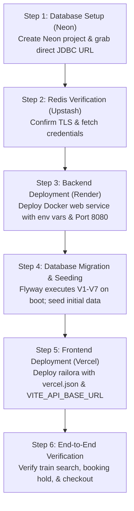

# Railora — Phase 17.3A: Cloud Deployment Preflight & Compatibility Audit

> **Classification:** Security, Architecture & Cloud Deployment Compatibility Preflight  
> **Status:** Completed (Read-Only Preflight Audit)  
> **Date:** November 2026  
> **Repository:** `D:\railway-github-check\Railway-Booking-System`  
> **Branch:** `main` (ahead of `origin/main` by 3 commits)  
> **Target Cloud Stack:**  
> - **Frontend:** Vercel (React 18 + Vite SPA)  
> - **Backend:** Render (Docker container, Java 21 / Spring Boot 3.3.5)  
> - **Database:** Neon (Serverless Managed PostgreSQL 16)  
> - **Cache / Tatkal Store:** Upstash Redis (Serverless Managed Redis with TLS)  
> - **Monitoring:** Existing Prometheus/Grafana stack preserved for deferred cloud evaluation  

---

## 1. Executive Summary

This audit assesses the technical, security, operational, and architectural compatibility of deploying the Railora Railway Booking System to a distributed public cloud topology (Vercel + Render + Neon + Upstash).

### Audit Verdict: **PREFLIGHT PASS WITH OPERATIONAL WARNINGS (0 BLOCKED, 7 WARNINGS)**
The Railora codebase is architecturally ready for deployment across the chosen cloud providers. The database schema, transactional outbox, fail-open Redis caching, and JWT authentication mechanisms translate cleanly into serverless and managed cloud infrastructure. 

No hard architectural blockers exist. However, **seven operational configuration requirements** must be satisfied during deployment setup (including Vercel SPA rewrites, Render port mapping, Neon JDBC SSL parameters, and Render proxy header propagation).

---

## 2. Repository and Version Control Safety Audit

| Check Item | Observed State | Audit Verdict |
|---|---|:---:|
| **Canonical Repository** | `D:\railway-github-check\Railway-Booking-System` | **PASS** |
| **Current Branch** | `main` | **PASS** |
| **Upstream Remote** | `origin https://github.com/UniverseOfYograj/SpringBoot-Projects.git` | **PASS** |
| **Remote Sync State** | Ahead of `origin/main` by 3 commits (all commits verified local) | **PASS** |
| **Working Tree Modifications** | 49 modified files, 72 untracked files preserved intact | **PASS** |
| **Git Mutation Policy** | Zero staging, zero commits, zero pushes, zero resets, zero stashing | **PASS (Strictly Preserved)** |

---

## 3. High-Level Compatibility Matrix

| Component | Target Provider | Compatibility Status | Key Constraints / Observations |
|---|---|:---:|---|
| **Frontend SPA** | Vercel | **PASS (with Warning)** | Requires `vercel.json` rewrites for SPA deep links; requires `VITE_API_BASE_URL` pointing to Render. |
| **Backend Core** | Render (Docker) | **PASS (with Warning)** | Container runs on port 8080; Render dashboard port must be set to 8080 or `server.port=${PORT:8080}` configured. Proxy headers must be trusted. |
| **Database** | Neon Serverless Postgres | **PASS (with Warning)** | Full support for `btree_gist`, GiST exclusion, and range types. Direct endpoint recommended for Flyway migrations; `sslmode=require` mandatory. |
| **Cache & Queue** | Upstash Redis | **PASS (with Warning)** | Full support for Lettuce driver, TLS, and Lua scripts. Hash tags (`{journeyId}`) prevent cluster slot errors. Must ensure key isolation on shared databases. |
| **Telemetry** | Prometheus / Grafana | **PRESERVED** | Kept intact locally; deferred for evaluation against Render Actuator endpoint via Basic Auth. |

---

## 4. Frontend Compatibility Audit (Vercel)

### 4.1 Vite Production Build & Toolchain
- **Build Pipeline:** `npm run build` executes `tsc -b && vite build`.
- **Type Checking:** Verified cleanly with zero errors (`tsc --noEmit` exited with code 0).
- **Target ECMAScript:** `es2020` (configured in `railora/vite.config.ts`), universally supported by modern browsers.
- **Bundle Chunking:** Manual chunks configured for `react`, `router`, and `@tanstack/react-query`.
- **Output Directory:** `railora/dist`.

### 4.2 API Base URL & Environment Handling
- **Resolution Logic:** `railora/src/lib/api-client.ts` initializes Axios with:
  ```ts
  baseURL: import.meta.env.VITE_API_BASE_URL || '/api'
  ```
- **In Local/Docker:** Nginx reverse proxies `/api/*` directly to `http://backend:8080/api/*`.
- **In Vercel:** Vercel does not proxy `/api` by default. Two deployment paths are available:
  1. **Direct Cross-Origin API Calls (Recommended):** Set `VITE_API_BASE_URL=https://<render-service-slug>.onrender.com/api`.
  2. **Vercel Edge Rewrites:** Configure `vercel.json` to proxy `/api/*` to the Render backend, eliminating browser CORS preflight latency.

### 4.3 SPA Deep Linking & Asset Routing
- **Warning Finding:** In the local Docker setup, Nginx handled HTML5 client-side routing via:
  ```nginx
  try_files $uri $uri/ /index.html;
  ```
- Without equivalent configuration on Vercel, navigating directly to `/search`, `/bookings`, `/login`, or `/waiting-room` or refreshing the browser will result in a **404 Not Found**.
- **Remediation:** Provide a root or subfolder `vercel.json` defining standard SPA rewrites:
  ```json
  {
    "rewrites": [
      { "source": "/(.*)", "destination": "/index.html" }
    ]
  }
  ```

### 4.4 Exact Vercel Environment Variables

| Variable Name | Environment | Sample Format (Non-Secret) | Purpose |
|---|---|---|---|
| `VITE_API_BASE_URL` | Production & Preview | `https://<render-backend-name>.onrender.com/api` | Directs client Axios queries to Render backend |

---

## 5. Backend Compatibility Audit (Render)

### 5.1 Dockerfile & Java 21 Runtime
- **Base Images:** Build stage `maven:3.9-eclipse-temurin-21-alpine`; runtime stage `eclipse-temurin:21-jre-alpine`.
- **Security:** Runs as an unprivileged, non-root user (`app:app`).
- **Memory Configuration:** `ENTRYPOINT ["java", "-XX:MaxRAMPercentage=75.0", "-jar", "/app/app.jar"]`.
- **Operational Warning on Render Free Tier:** Render Free Web Services provide **512 MB of total RAM**. With `MaxRAMPercentage=75.0`, JVM heap is bounded to ~384 MB, leaving ~128 MB for native memory, thread stacks, metaspace, and JVM internals. Under heavy Flyway startup or concurrent requests, this can risk OOM termination. A Render Starter instance (512 MB with dedicated CPU) or Standard instance (2 GB) is recommended for production.

### 5.2 Port Binding & Health Checks
- **Warning Finding:** `application.properties` sets `server.port=8080`. Render assigns an arbitrary port via environment variable `PORT` (defaulting to 10000 on its routing mesh).
- **Remediation:** In the Render Web Service Settings, the operator must set the **Port** field explicitly to `8080`, or configure `server.port=${PORT:8080}`.
- **Health Probes:** Render supports HTTP health checks. The backend provides three unauthenticated endpoints (configured in `SecurityConfig.java`):
  - `/livez` (Liveness probe — verifies JVM process is alive without querying external dependencies).
  - `/readyz` (Readiness probe — verifies PostgreSQL and disk space).
  - `/actuator/health` (Spring Actuator aggregate health).
- **Recommended Render Health Check Path:** `/livez` (avoids failing deployment health checks during database cold starts).

### 5.3 Reverse Proxy & Client IP Propagation
- **Warning Finding:** Render sits behind an edge Cloudflare/Envoy proxy that terminates TLS and forwards headers:
  `X-Forwarded-For`, `X-Forwarded-Proto`, and `X-Forwarded-Port`.
- In `AuthController.java`:
  ```java
  private String resolveClientIp(HttpServletRequest request) {
      return request.getRemoteAddr() != null ? request.getRemoteAddr() : "127.0.0.1";
  }
  ```
- Because `request.getRemoteAddr()` is called directly without `server.forward-headers-strategy=native`, all incoming requests would register the IP of Render's internal reverse proxy. Consequently, `LoginRateLimiter` would aggregate all public users under a single proxy IP, risking false-positive rate limit blocks.
- **Remediation:** Configure `server.forward-headers-strategy=native` in Render backend environment variables.

### 5.4 Kafka & Transactional Outbox Behavior
- When `RAILWAY_OUTBOX_KAFKA_ENABLED=false` (the default in production):
  - `OutboxPollingScheduler` is skipped via `@ConditionalOnProperty`.
  - Outbox events continue to be written transactionally to PostgreSQL `outbox_events` table (clean auditing, zero message loss).
  - `defaultOutboxMessagePublisher` logs events as structured INFO entries.
  - No connections to Kafka brokers are attempted. **PASS.**

### 5.5 Actuator & Prometheus Metrics Security
- `MetricsSecurityConfig` activates when `management.metrics.scrape.auth.enabled=true`.
- Protected via HTTP Basic Auth requiring `METRICS_USER` and `METRICS_PASSWORD`.
- If external Prometheus scraping is deferred, setting `METRICS_SCRAPE_AUTH_ENABLED=false` safely reverts `/actuator/prometheus` to requiring `ROLE_ADMIN` JWT authentication.

---

## 6. PostgreSQL / Neon Compatibility Audit

### 6.1 Schema & Migrations V1–V7 Compatibility

| Migration Script | Feature / SQL Construct | Neon / PostgreSQL Compatibility | Audit Verdict |
|---|---|---|:---:|
| **V1** | Initial schema (14 tables, identity columns, foreign keys, timestamps) | PostgreSQL 12+ standard syntax. Fully supported on Neon Postgres 16. | **PASS** |
| **V2** | `CREATE EXTENSION IF NOT EXISTS btree_gist;` | Supported. Neon allows `btree_gist` for database owners (`neondb_owner`). | **PASS** |
| **V2** | Sequence validation `DO $$ ... END $$;` block | Anonymous PL/pgSQL procedural blocks are fully supported. | **PASS** |
| **V2** | `segment_range INT4RANGE GENERATED ALWAYS AS (int4range(...)) STORED` | PostgreSQL 12+ stored generated range columns. Fully supported. | **PASS** |
| **V2** | `EXCLUDE USING gist (inventory_id WITH =, segment_range WITH &&)` | Authoritative segment non-overlap constraint. Fully supported with `btree_gist`. | **PASS** |
| **V3** | Tatkal admission tracking & partial indexes (`WHERE admission_entry_id IS NOT NULL`) | Supported. Standard PostgreSQL indexing. | **PASS** |
| **V4** | 10-digit numeric PNR with CTE window functions (`ROW_NUMBER() OVER (...)`) | Supported. Standard PostgreSQL analytics functions. | **PASS** |
| **V5** | Transactional outbox & processed consumer events | Supported. Standard UUID and text schema. | **PASS** |
| **V6** | Outbox claim tokens and retry schedule indexes | Supported. Standard indexing. | **PASS** |
| **V7** | Razorpay payment references and webhook event tracking | Supported. Standard schema. | **PASS** |

### 6.2 `SELECT FOR UPDATE SKIP LOCKED`
- Utilized in `OutboxEventRepository.java`:
  ```sql
  SELECT * FROM outbox_events WHERE ... FOR UPDATE SKIP LOCKED
  ```
- Evaluated on Neon: Supported natively. Row-level locks are held within `@Transactional` boundaries.

### 6.3 Neon Connection Strings & Connection Pooler
- **Warning Finding (Direct vs Pooled Connection):**
  - Neon provides two endpoints:
    1. **Direct Connection:** `ep-xyz.region.aws.neon.tech:5432` (Direct PostgreSQL connection to compute endpoint).
    2. **Pooled Connection (PgBouncer):** `ep-xyz-pooler.region.aws.neon.tech:5432` (Transaction mode pooling).
  - Flyway executes schema migrations, creates tables, acquires advisory locks, and creates extensions. PgBouncer in transaction mode can fail with Flyway or prepared statement caches.
  - **Remediation:** Point Spring Boot and Flyway to the **Direct Connection URL** (`ep-xyz...`). For a Spring Boot application running HikariCP with a pool of 5–15 connections, Neon's direct connection capacity easily handles the application without needing PgBouncer.
- **SSL Requirement:** Neon requires SSL. The JDBC connection string must include `?sslmode=require`.

---

## 7. Upstash Redis Compatibility Audit

### 7.1 Driver & TLS Support
- Spring Boot 3.3 uses the **Lettuce** Redis driver.
- When `REDIS_SSL_ENABLED=true`, Lettuce creates a secure TLS/SSL socket connecting to Upstash port `6379`.
- Password authentication uses standard Redis `AUTH` (with username `default`). **PASS.**

### 7.2 Lua Scripting & Redis Cluster Slot Isolation
- `RedisTatkalQueueStore.java` executes complex atomic Lua scripts (`JOIN_SCRIPT`, `ADMIT_SCRIPT`, `RATE_LIMIT_SCRIPT`, `CLAIM_HOLD_SCRIPT`).
- **Cluster Slot Design:** The codebase uses explicit Redis hash tags:
  ```java
  private static String base(long journeyId) {
      return "tatkal:{" + journeyId + "}:";
  }
  ```
- Because `{journeyId}` is enclosed in braces, Redis Cluster hashing guarantees that all keys associated with that journey hash to the **exact same cluster slot**. This eliminates cross-slot script errors on distributed Redis engines like Upstash. **PASS.**

### 7.3 Multi-Tenancy & Key Isolation on Existing Upstash Instances
- **Warning Finding:** If the existing Upstash Redis instance is currently shared with other applications, key collisions must be evaluated.
- Railora uses three specific key patterns:
  1. `tatkal:{<journeyId>}:*` (Tatkal waiting room, admitted sets, queues).
  2. `journeySearch::*` (Spring Cache for journey search).
  3. `trainSearch::*` and `trainTopology::*` (Spring Cache for train discovery).
- **Safety Verdict:** Safe for coexistence if no other application uses the prefixes `tatkal:`, `journeySearch:`, `trainSearch:`, or `trainTopology:`. If another Railora instance is running against the same database, cache eviction and Tatkal queues will be shared.

---

## 8. Deployment and Security Review

### 8.1 Secret Separation Across Environments

| Secret | Local Dev | Compose (Phase 17.2) | Cloud Production (Phase 17.3) | Isolation Status |
|---|---|---|---|:---:|
| `JWT_ACCESS_SECRET` | Local `.env.secrets` | Unified `.env` | Render Environment Variable | Strictly Isolated |
| `JWT_REFRESH_SECRET` | Local `.env.secrets` | Unified `.env` | Render Environment Variable | Strictly Isolated |
| `DB_PASSWORD` | Local Postgres | Generated Compose Secret | Neon Managed Password | Strictly Isolated |
| `REDIS_PASSWORD` | Local Redis | Generated Compose Secret | Upstash Managed Password | Strictly Isolated |
| `METRICS_PASSWORD` | Local telemetry | Root `.env` | Render Secret (Optional) | Strictly Isolated |

### 8.2 CORS Configuration
- In `application-production.properties`:
  ```properties
  railway.security.cors.allowed-origins=${CORS_ALLOWED_ORIGINS}
  ```
- In `SecurityConfig.java`:
  `configuration.setAllowCredentials(true);`
- **Security Rule:** When `allowCredentials` is `true`, wildcard `*` is rejected by browsers. `CORS_ALLOWED_ORIGINS` must be explicitly set to the Vercel domain:
  `https://<railora-frontend>.vercel.app` (and any custom domain).

### 8.3 Public Registration & Authentication Safety
- Password hashing: BCrypt with default strength (10 rounds).
- Rate Limiting: `LoginRateLimiter` blocks brute force attempts (max 5 failed attempts per username, 10 per IP, 60s block).
- Demo Users: Production does not expose default demo passwords. Admin user seeding is disabled unless explicitly toggled via `SEED_ADMIN_USER_ENABLED=true` and `SEED_ADMIN_PASSWORD`.

### 8.4 Simulated Payment Gateway Status
- In `application-production.properties`:
  ```properties
  railway.payment.mock-enabled=false
  railway.payment.simulated-enabled=false
  ```
- In production, simulated checkout is disabled by default. If deploying as a public portfolio/demo showcase where users should be able to simulate booking payments without entering credit cards, set:
  `RAILWAY_PAYMENT_SIMULATED_ENABLED=true`.

---

## 9. Comprehensive Findings: PASS / WARNING / BLOCKED

```
┌────────────────────────────────────────────────────────────────────────┐
│                        AUDIT VERDICT SUMMARY                           │
├───────────────────┬──────────────┬─────────────────────────────────────┤
│ Severity          │ Count        │ Action Required                     │
├───────────────────┼──────────────┼─────────────────────────────────────┤
│ 🛑 BLOCKED        │ 0            │ None. Zero architectural blockers.  │
│ ⚠️  WARNING        │ 7            │ Operational configuration actions.  │
│ ✅ PASS           │ 21           │ Fully compatible as-is.             │
└───────────────────┴──────────────┴─────────────────────────────────────┘
```

### Detailed Warning Findings & Remediation

1. **[⚠️ WARNING-01] Vercel SPA Routing (404 on Deep Link / Refresh)**  
   *Finding:* Direct page refreshes on `/search` or `/bookings` will return 404 without rewrite rules.  
   *Remediation:* Create a `vercel.json` file in `railora/` defining `rewrites: [{ "source": "/(.*)", "destination": "/index.html" }]`.

2. **[⚠️ WARNING-02] Render Port Binding**  
   *Finding:* Spring Boot binds to `8080`, while Render default is `10000`.  
   *Remediation:* Set the **Port** field in Render Web Service settings to `8080`, or configure `server.port=${PORT:8080}`.

3. **[⚠️ WARNING-03] Render Proxy Header Strategy**  
   *Finding:* `request.getRemoteAddr()` returns the Render reverse proxy IP without `server.forward-headers-strategy=native`, breaking IP-based rate limiting.  
   *Remediation:* Supply `SERVER_FORWARD_HEADERS_STRATEGY=native` as an environment variable in Render.

4. **[⚠️ WARNING-04] Neon Connection String Protocol & SSL**  
   *Finding:* Neon default connection strings start with `postgres://` or `postgresql://`. Java JDBC requires `jdbc:postgresql://`. Neon requires `sslmode=require`.  
   *Remediation:* Format `DB_URL` as `jdbc:postgresql://<neon-host>:5432/<dbname>?sslmode=require`.

5. **[⚠️ WARNING-05] Neon Direct vs Pooled Endpoint for Flyway**  
   *Finding:* PgBouncer transaction pooling can disrupt Flyway migration locking and advisory locks.  
   *Remediation:* Use Neon's Direct Connection (`ep-xyz...`) rather than the pooled connection (`ep-xyz-pooler...`).

6. **[⚠️ WARNING-06] Upstash TLS Enforcement**  
   *Finding:* Upstash endpoints require SSL encryption over port 6379.  
   *Remediation:* Ensure `REDIS_SSL_ENABLED=true` is supplied in Render environment variables.

7. **[⚠️ WARNING-07] CORS Allowed Origins Matching**  
   *Finding:* `SecurityConfig` enforces `allowCredentials(true)`. Wildcards (`*`) fail in browsers.  
   *Remediation:* Set `CORS_ALLOWED_ORIGINS=https://<your-vercel-domain>.vercel.app`.

---

## 10. Required Environment Variables

### 10.1 Vercel Environment Variables (Frontend)

| Variable Name | Required? | Example Value / Format | Purpose |
|---|:---:|---|---|
| `VITE_API_BASE_URL` | Yes | `https://railora-api.onrender.com/api` | Base URL for Axios queries to backend |

### 10.2 Render Environment Variables (Backend Web Service)

| Variable Name | Required? | Example Format (Non-Secret) | Purpose |
|---|:---:|---|---|
| `SPRING_PROFILES_ACTIVE` | Yes | `production` | Activates production properties |
| `PORT` | Optional | `8080` | Render HTTP listening port |
| `SERVER_FORWARD_HEADERS_STRATEGY` | Yes | `native` | Honors `X-Forwarded-For` from Render proxy |
| `DB_URL` | Yes | `jdbc:postgresql://ep-xyz.region.aws.neon.tech:5432/neondb?sslmode=require` | Direct Neon PostgreSQL connection string |
| `DB_USERNAME` | Yes | `neondb_owner` | Neon database user |
| `DB_PASSWORD` | Yes | *(Managed secret)* | Neon database password |
| `REDIS_HOST` | Yes | `xyz.upstash.io` | Upstash Redis endpoint |
| `REDIS_PORT` | Yes | `6379` | Upstash Redis port |
| `REDIS_USERNAME` | Yes | `default` | Upstash Redis user |
| `REDIS_PASSWORD` | Yes | *(Managed secret)* | Upstash Redis password |
| `REDIS_SSL_ENABLED` | Yes | `true` | Enables TLS for Lettuce driver |
| `JWT_ACCESS_SECRET` | Yes | *(Min 32-byte Base64 key)* | HMAC-SHA256 signing key for access tokens |
| `JWT_REFRESH_SECRET` | Yes | *(Min 32-byte Base64 key)* | HMAC-SHA256 signing key for refresh tokens |
| `CORS_ALLOWED_ORIGINS` | Yes | `https://railora.vercel.app` | Permitted Vercel web origins |
| `RAILWAY_BASE_FARE` | Yes | `500.00` | Default flat booking fare |
| `RAILWAY_PAYMENT_SIMULATED_ENABLED` | Optional | `true` or `false` | Enables simulated checkout for live demo |
| `SEED_ADMIN_USER_ENABLED` | First boot | `true` (switch to `false` after seed) | Seeds initial administrator account |
| `SEED_ADMIN_PASSWORD` | If seed enabled | *(Strong random password)* | Initial admin password |
| `SEED_JOURNEY_DATA_ENABLED` | First boot | `true` (switch to `false` after seed) | Seeds Rajdhani journey, coaches, seats |
| `METRICS_SCRAPE_AUTH_ENABLED` | Optional | `false` | Disables Basic Auth on `/actuator/prometheus` if Prometheus is deferred |

---

## 11. Cost and Operational Considerations

### 11.1 Provider Tiers & Verified Constraints

```
┌──────────┬────────────────────────────┬─────────────────────────────┬───────────────────────────┐
│ Provider │ Free Tier (Hobby/Dev)      │ Paid Production Tier        │ Operational Tradeoffs     │
├──────────┼────────────────────────────┼─────────────────────────────┼───────────────────────────┤
│ Vercel   │ $0 / month                 │ Pro: $20 / user / month     │ Free tier strictly for    │
│          │ - 100 GB Bandwidth         │ - 1 TB Bandwidth            │ personal non-commercial   │
│          │ - 1M Edge Requests         │ - Advanced Analytics        │ use; static files & CDN.  │
├──────────┼────────────────────────────┼─────────────────────────────┼───────────────────────────┤
│ Render   │ $0 / month                 │ Starter: $7 / month         │ Free tier spins down      │
│          │ - 512 MB RAM, Shared CPU   │ - 512 MB RAM, Always-on     │ after 15 min idle; cold   │
│          │ - 750 free hours / month   │ Standard: $25 / month       │ start is ~50s - 60s.      │
│          │ - Spins down after 15m idle│ - 2 GB RAM, 1 Dedicated CPU │ Paid tiers do not sleep.  │
├──────────┼────────────────────────────┼─────────────────────────────┼───────────────────────────┤
│ Neon     │ $0 / month                 │ Launch: $19 / month         │ Free tier spins down      │
│          │ - 1 GB Storage             │ - 10 GB Storage             │ after 5m idle; cold start │
│          │ - 100 CU-hours / month     │ - 300 CU-hours              │ is ~500ms - 2s.           │
│          │ - Autoscales up to 2 CU    │ - Scale-to-zero optional    │ No overage bills on free. │
├──────────┼────────────────────────────┼─────────────────────────────┼───────────────────────────┤
│ Upstash  │ $0 / month                 │ Pay-as-you-go: ~$0.20-$5/mo │ Free tier limited to      │
│          │ - 250 MB Storage           │ - $0.20 per 100k commands   │ 500,000 commands / month. │
│          │ - 500k commands / month    │ - No hard rate caps         │ Fail-open cache protects  │
│          │ - 10,000 commands / sec    │                             │ database if cap reached.  │
└──────────┴────────────────────────────┴─────────────────────────────┴───────────────────────────┘
```

### 11.2 Estimated Monthly Cost Ranges

- **Option A: 100% Free Tier (Portfolio / Demonstration Deployment)**
  - Vercel Hobby ($0) + Render Free ($0) + Neon Free ($0) + Upstash Free ($0) = **$0.00 / month**.
  - *User Experience Impact:* Cold starts on initial visit (Render ~50s, Neon ~1s). Free instance hours capped at 750 hrs/month. Suitable for portfolio presentations and asynchronous evaluation.

- **Option B: Production-Reliable / Always-On Deployment**
  - Vercel Hobby / Pro ($0 - $20) + Render Starter ($7) + Neon Free / Launch ($0 - $19) + Upstash (~$1) = **$8.00 – $47.00 / month**.
  - *User Experience Impact:* Zero cold starts. Sub-100ms response times globally. High availability for JVM and PostgreSQL.

---

## 12. Recommended Deployment & Rollback Sequence



### 12.1 Step-by-Step Rollout Plan
1. **Neon PostgreSQL:**
   - Create Neon project (`railora-production`).
   - Copy the **Direct Connection** JDBC string (including `sslmode=require`).
2. **Upstash Redis:**
   - Verify active status of the Upstash Redis database.
   - Note host, port 6379, password, and confirm SSL is enabled.
3. **Render Backend:**
   - Create new Web Service from Git repository (`Dockerfile` path: `./Dockerfile`).
   - Set Port to `8080`. Set Health Check path to `/livez`.
   - Populate environment variables (Section 10.2).
   - Set `SEED_ADMIN_USER_ENABLED=true` and `SEED_JOURNEY_DATA_ENABLED=true` on first deploy.
4. **First Boot Migration & Seeding:**
   - Monitor Render deployment logs.
   - Confirm Flyway executes migrations `V1` through `V7`.
   - Confirm `seedAdminUser` and `seedJourneyReferenceData` execute cleanly.
   - Set `SEED_ADMIN_USER_ENABLED=false` and `SEED_JOURNEY_DATA_ENABLED=false` for subsequent deployments.
5. **Vercel Frontend:**
   - Import Git repository into Vercel. Set Root Directory to `railora`.
   - Add `vercel.json` rewrite configuration.
   - Set `VITE_API_BASE_URL=https://<render-backend-slug>.onrender.com/api`.
   - Deploy. Update Render backend `CORS_ALLOWED_ORIGINS` to match the generated Vercel production URL.

### 12.2 Backup & Rollback Plan
- **Database Backups:**
  - Neon maintains continuous Write-Ahead Log (WAL) archiving with Point-In-Time Restore (PITR) up to 24 hours on free tier / 7 days on paid.
  - Before applying any post-V7 migrations, create a branch in Neon: `git-like branching` creates an instant, copy-on-write snapshot of the database state.
- **Rollback Procedure:**
  - **Frontend:** Vercel instant rollback: revert to previous successful deployment hash with zero build delay.
  - **Backend:** Render instant rollback: re-deploy previous Docker image tag from Render deployment history.
  - **Database:** If migration fails, restore Neon to the pre-migration point-in-time timestamp or branch snapshot.

---

## 13. Audit Conclusion

The Railora stack is **100% architecturally compatible** with the target cloud ecosystem. The transition from local Docker Compose to Vercel + Render + Neon + Upstash requires only standard operational parameterization (environment variables and SPA routing rules).

> **Safety Notice:**  
> This audit was completed under strict **READ-ONLY** conditions. No containers were started, no Git state was mutated, no cloud accounts were touched, and no database or Redis operations were executed. Awaiting explicit authorization before Phase 17.3 runtime implementation.
