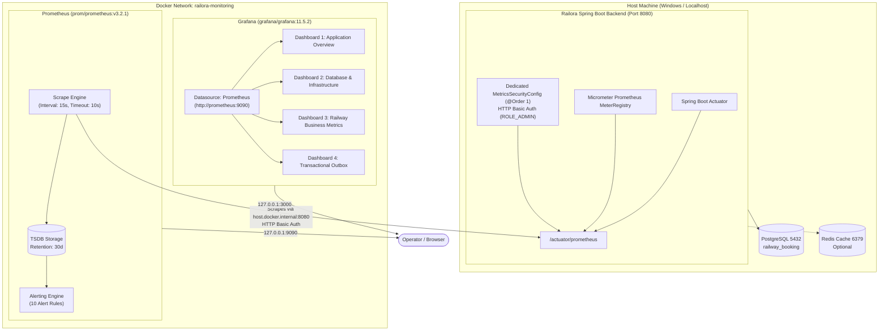

# Railora Observability Stack (Phase 15C)

Local, production-grade monitoring infrastructure for the Railora Railway Booking System built with **Prometheus** and **Grafana**, integrating with **Spring Boot 4 Actuator** and **Micrometer**.

---

## 1. Architecture Overview

The monitoring architecture provides end-to-end visibility across application runtime, database connection pooling, transactional outbox reliability, and railway business operations.



---

## 2. Directory Structure

```text
monitoring/
├── docker-compose.yml              # Pinned service definitions, localhost bindings, health checks
├── .env.example                    # Template for scrape and admin credentials
├── secrets/                        # Git-ignored local secrets directory
│   ├── metrics_password            # Prometheus Basic Auth password file (mounted :ro)
│   └── metrics_password.example    # Template for local secret initialization
├── README.md                       # Comprehensive operational guide
├── prometheus/
│   ├── prometheus.yml              # Prometheus scrape configuration with basic_auth
│   └── alerts/
│       └── railora-alerts.yml      # 10 production alert rules
└── grafana/
    ├── provisioning/
    │   ├── datasources/
    │   │   └── prometheus.yml      # Automated Prometheus datasource provisioning
    │   └── dashboards/
    │       └── dashboards.yml      # Automated dashboard folder provisioning
    └── dashboards/
        ├── railora-application-overview.json       # HTTP, latency, JVM, threads, CPU
        ├── railora-database-infrastructure.json   # HikariCP pool, disk space, metaspace
        ├── railora-business-metrics.json          # Bookings, payments, cancellations, conflicts
        └── railora-transactional-outbox.json      # Outbox states (PENDING/CLAIMED/etc.), publish latency
```

---

## 3. Quick Start Guide

### Step 1: Configure Environment Variables
Copy the template and set strong credentials:
```bash
cp monitoring/.env.example monitoring/.env
```
Edit `monitoring/.env` and replace default placeholder secrets:
```dotenv
METRICS_USER=promuser
METRICS_PASSWORD=YourStrongSecureScrapePassword123!
GF_SECURITY_ADMIN_USER=admin
GF_SECURITY_ADMIN_PASSWORD=YourStrongSecureGrafanaPassword123!
PROMETHEUS_RETENTION=30d
```

### Step 2: Configure Spring Boot Backend
Ensure the backend is started with scrape authentication enabled and matching credentials:
```powershell
$env:METRICS_SCRAPE_AUTH_ENABLED = "true"
$env:METRICS_USER = "promuser"
$env:METRICS_PASSWORD = "YourStrongSecureScrapePassword123!"
.\mvnw.cmd spring-boot:run
```

### Step 3: Start the Monitoring Stack
Start Prometheus and Grafana with Docker Compose:
```bash
docker compose --env-file monitoring/.env -f monitoring/docker-compose.yml up -d
```

### Step 4: Access UIs
- **Prometheus UI & Targets**: [http://127.0.0.1:9090](http://127.0.0.1:9090)
  - Targets status: [http://127.0.0.1:9090/targets](http://127.0.0.1:9090/targets)
  - Active alert rules: [http://127.0.0.1:9090/alerts](http://127.0.0.1:9090/alerts)
- **Grafana UI**: [http://127.0.0.1:3000](http://127.0.0.1:3000)
  - Username: `${GF_SECURITY_ADMIN_USER}` (default: `admin`)
  - Password: `${GF_SECURITY_ADMIN_PASSWORD}`

---

## 4. Security Architecture

1. **Dedicated Metrics Security Chain**:
   - `MetricsSecurityConfig` runs at `@Order(1)`, executing before the main JWT filter chain.
   - Matches **only** `/actuator/prometheus`.
   - Uses dedicated in-memory credentials derived strictly from `METRICS_USER` and `METRICS_PASSWORD`.
   - Fails safely on startup if credentials are blank or missing when enabled.
2. **Chain Isolation**:
   - Metrics credentials **cannot** authenticate against `/api/**` business or administrative endpoints.
   - The primary JWT filter chain remains 100% stateless and isolated.
3. **Localhost Binding**:
   - All exposed Docker ports (`9090`, `3000`) are explicitly bound to `127.0.0.1`.
   - External network interfaces cannot reach Prometheus or Grafana.
4. **Credential Safety**:
   - No credentials or `.env` files are tracked in Git.

---

## 5. Metric Dictionary

### Custom Railora Business Metrics
| Prometheus Metric Name | Micrometer Name | Type | Key Labels | Description |
|---|---|---|---|---|
| `railora_booking_created_total` | `railora.booking.created` | Counter | `type`, `outcome`, `failure_reason` | Booking creation attempts by type (standard/tatkal) and outcome |
| `railora_payment_attempts_total` | `railora.payment.attempts` | Counter | `method`, `outcome`, `failure_reason` | Payment processing attempts (SIMULATED, RAZORPAY, MOCK_UPI) |
| `railora_booking_cancellations_total` | `railora.booking.cancellations` | Counter | `outcome`, `failure_reason` | Booking cancellation attempts and outcomes |
| `railora_seat_allocation_conflicts_total` | `railora.seat.allocation.conflicts` | Counter | `conflict_type` | Seat hold or allocation collision events |
| `railora_tatkal_queue_requests_total` | `railora.tatkal.queue.requests` | Counter | `action`, `outcome` | Tatkal queue admission requests and rate limits |
| `railora_outbox_events` | `railora.outbox.events` | Gauge | `status` | Snapshot count of outbox events (`PENDING`, `CLAIMED`, `PUBLISHED`, `FAILED`, `DEAD`) |
| `railora_outbox_publish_attempts_total` | `railora.outbox.publish.attempts` | Counter | `event_type`, `outcome` | Attempts to publish events to message broker |
| `railora_outbox_publish_duration_seconds_*` | `railora.outbox.publish.duration` | Summary/Timer | `event_type`, `quantile` | Time spent dispatching events to Kafka/broker |

### Infrastructure & Operational Metrics
| Metric Name | Type | Description |
|---|---|---|
| `http_server_requests_seconds_*` | Timer/Histogram | Inbound HTTP request rates, latencies, and response codes (`uri`, `status`, `method`) |
| `hikaricp_connections_active` | Gauge | Active database connections currently acquired by threads |
| `hikaricp_connections_idle` | Gauge | Idle database connections ready in `RailoraHikariPool` |
| `hikaricp_connections_pending` | Gauge | Application threads waiting for a free database connection |
| `hikaricp_connections_timeout_total` | Counter | Total connection acquisition timeout events |
| `jvm_memory_used_bytes` | Gauge | Memory utilization by area (`heap`, `nonheap`) |
| `jvm_gc_pause_seconds_*` | Timer | JVM garbage collector pause frequency and duration |
| `jvm_threads_live_threads` | Gauge | Active JVM threads |
| `process_cpu_usage` | Gauge | Application process CPU utilization fraction (0.0 - 1.0) |
| `disk_free_bytes` | Gauge | Available disk storage on the application host |

---

## 6. Dashboard Catalog

### 1. Railora — Application Overview (`railora-application-overview.json`)
- **Target Audience**: Site Reliability Engineers & Backend Developers.
- **Panels**:
  - Application Status (Stat: UP / DOWN)
  - Process Uptime (Stat: formatted duration)
  - Total HTTP Throughput (Stat: req/s)
  - HTTP 5xx Error Rate (Stat: errors/s with red alert threshold)
  - HTTP Request Rate by Status Code (Timeseries)
  - HTTP Latency Quantiles: p50, p95, p99 (Timeseries)
  - JVM Memory Usage: Heap Used vs Heap Max vs Non-Heap (Timeseries)
  - CPU Usage: Process % vs System % (Timeseries)
  - JVM Thread Count: Live, Peak, Daemon (Timeseries)
  - JVM GC Pause Duration & Frequency (Timeseries)

### 2. Railora — Database & Infrastructure (`railora-database-infrastructure.json`)
- **Target Audience**: Database Administrators & Infrastructure Engineers.
- **Panels**:
  - HikariCP Active Connections (Stat with saturation thresholds)
  - HikariCP Idle Connections (Stat)
  - Threads Pending Connection (Stat with red warning threshold)
  - HikariCP Timeouts in last 5m (Stat with critical alert threshold)
  - HikariCP Connection Pool Utilization: Active, Idle, Min, Max (Timeseries)
  - HikariCP Average Acquire & Usage Duration (Timeseries)
  - Disk Space Utilization: Free vs Total (Timeseries)
  - JVM Metaspace Memory: Used vs Committed (Timeseries)

### 3. Railora — Railway Business Metrics (`railora-business-metrics.json`)
- **Target Audience**: Product Owners & Business Operations.
- **Panels**:
  - Successful Bookings (Stat)
  - Successful Payments (Stat)
  - Failed Payments (Stat)
  - Total Cancellations (Stat)
  - Seat Conflicts (Stat)
  - Booking Creation Rate by Journey Type (Timeseries)
  - Payment Attempts by Gateway Method & Outcome (Timeseries)
  - Payment Failures Breakdown by Failure Reason (Timeseries)
  - Booking Cancellation Rate (Timeseries)
  - Seat Allocation Conflicts Rate (Timeseries)
  - Tatkal Queue Admission Activity (Timeseries)

### 4. Railora — Transactional Outbox (`railora-transactional-outbox.json`)
- **Target Audience**: Event-Driven Integration & Data Consistency Engineers.
- **Panels**:
  - PENDING Events in Backlog (Stat with warning thresholds)
  - CLAIMED Events (Stat)
  - PUBLISHED Events (Stat)
  - FAILED Events (Stat)
  - DEAD / Poison Pill Events (Stat with immediate critical red threshold)
  - Transactional Outbox Event States Trend (Timeseries)
  - Outbox Publish Attempts by Event Type & Outcome (Timeseries)
  - Outbox Message Broker Publish Duration p50/p95 (Timeseries)
  - Outbox Publish Failure Rate (Timeseries)

---

## 7. Alert Rules Reference

The Prometheus configuration loads 10 production-tested alerts configured in `monitoring/prometheus/alerts/railora-alerts.yml`:

| # | Alert Name | Severity | Condition (PromQL) | Window | Description & Operator Action |
|---|---|---|---|---|---|
| 1 | `RailoraDown` | Critical | `up{job="railora"} == 0` | 1m | Backend application is unresponsive. Check process status, JVM crashes, and port 8080. |
| 2 | `ReadinessDown` | Warning | `up{job="railora"} == 0 or absent(up{job="railora"}) == 1` | 2m | Backend service readiness has degraded. Check database and disk space. |
| 3 | `Http5xxSpike` | Warning | `sum(rate(http_server_requests_seconds_count{status=~"5.."}[5m])) > 0.5` | 2m | HTTP 5xx error rate exceeds 0.5 req/s. Inspect application logs for unhandled exceptions. |
| 4 | `HighP95Latency` | Warning | `histogram_quantile(0.95, sum(rate(http_server_requests_seconds_bucket[5m])) by (le)) > 2` | 3m | p95 HTTP response latency exceeds 2 seconds. Check database lock contention and slow queries. |
| 5 | `HikariPoolSaturation` | Warning | `(hikaricp_connections_active / hikaricp_connections_max) > 0.8` | 3m | HikariCP pool is > 80% saturated. Check for unclosed connections or connection leaks. |
| 6 | `HikariConnectionTimeouts` | Critical | `sum(increase(hikaricp_connections_timeout_total[5m])) > 0` | 1m | Threads timed out waiting for a database connection. Expand pool size or optimize queries. |
| 7 | `OutboxDeadEvents` | Critical | `railora_outbox_events{status="DEAD"} > 0` | 1m | Poison pill events detected in Transactional Outbox. Requires manual database inspection. |
| 8 | `OutboxBacklogSustained` | Warning | `railora_outbox_events{status="PENDING"} > 100` | 10m | Outbox backlog sustained above 100 events. Verify Kafka broker status and publisher scheduler. |
| 9 | `JvmHeapPressure` | Warning | `(jvm_memory_used_bytes{area="heap"} / jvm_memory_max_bytes{area="heap"}) > 0.85` | 5m | JVM heap usage exceeds 85% for 5 minutes. Check for memory leaks or increase `-Xmx`. |
| 10 | `PaymentFailureSpike` | Warning | `sum(rate(railora_payment_attempts_total{outcome="failed"}[5m])) > 0.1` | 2m | Payment failure rate is elevated (> 0.1 failures/s). Check payment gateway connectivity. |

---

## 8. Prometheus Configuration & Hot Reload

Prometheus is launched with `--web.enable-lifecycle`. You can reload configuration without restarting the container:
```bash
curl -X POST http://127.0.0.1:9090/-/reload
```

---

## 9. Troubleshooting Guide

| Symptom | Probable Cause | Resolution |
|---|---|---|
| Target `host.docker.internal:8080` status is `DOWN` (Connection Refused) | Application not running on host or Docker cannot reach host gateway | Verify backend is running on port 8080; ensure `extra_hosts` is configured in `docker-compose.yml`. |
| Target status is `DOWN` (HTTP 401 Unauthorized) | Missing or invalid Basic Auth credentials | Verify `basic_auth` in `prometheus.yml` matches `METRICS_USER` and `METRICS_PASSWORD` in backend. |
| Target status is `DOWN` (HTTP 403 Forbidden) | Metrics user lacks `ROLE_ADMIN` | Verify user was granted `ROLE_ADMIN` in `MetricsSecurityConfig`. |
| Grafana cannot connect to Prometheus datasource | Prometheus service unhealthy or wrong URL | In Docker network, Grafana must use `http://prometheus:9090`, not `localhost:9090`. |
| Dashboards show "No Data" | No traffic has hit the application | Run a test search or booking flow to generate metrics. |
| Port 9090 or 3000 already in use | Conflicting local process | Identify conflict with `netstat -ano \| findstr 9090` and stop conflicting process or change port mapping. |

---

## 10. Operational Verification

1. **Verify Backend Metrics Endpoint Directly**:
   ```bash
   curl -u promuser:pr0mP@ss!Secure42 http://localhost:8080/actuator/prometheus
   ```
2. **Verify Prometheus Scraping**:
   Open [http://127.0.0.1:9090/targets](http://127.0.0.1:9090/targets) — `railora` target state must be `UP`.
3. **Verify Alert Rule Registration**:
   Open [http://127.0.0.1:9090/alerts](http://127.0.0.1:9090/alerts) — all 10 alerts must be listed.
4. **Verify Grafana Dashboards**:
   Open [http://127.0.0.1:3000](http://127.0.0.1:3000) -> Browse Dashboards -> `Railora` folder -> open all 4 dashboards.
